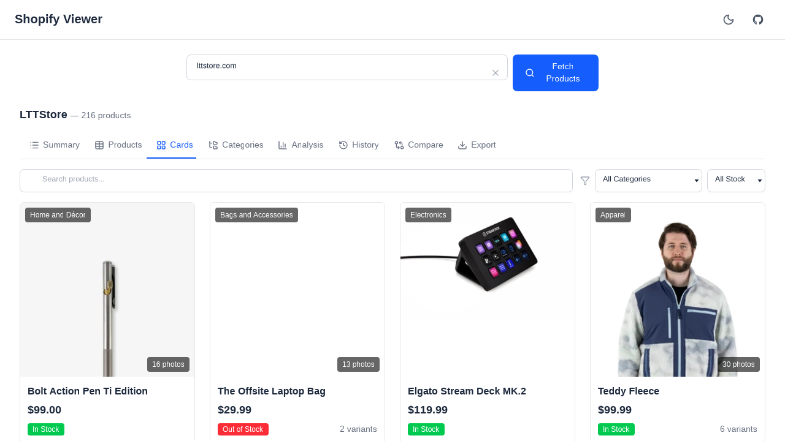

<h1 align="center">shopify-viewer</h1>

<p align="center"><strong>Paste a Shopify store URL. Browse its whole catalog in eight views.</strong></p>

<p align="center">
  <a href="https://github.com/StrongWind1/shopify-viewer/actions/workflows/ci.yml"></a>
  <a href="LICENSE"></a>
  <a href="https://strongwind.dev/shopify-viewer/"></a>
</p>

<p align="center">
  <a href="#quick-start">Quick start</a> &bull;
  <a href="#usage">Usage</a> &bull;
  <a href="https://strongwind.dev/shopify-viewer/">Live app</a>
</p>

---

shopify-viewer fetches every product from a Shopify store's public `/products.json` endpoint and lays the catalog out in eight views: product and variant tables, product cards, category and price breakdowns, price history, a two-store comparison, and CSV or JSON export. It runs in the browser with nothing to install, and replaces a Google Apps Script that dumped one hard-coded store into Google Sheets.

<p align="center">
  
</p>

## Features

- **Summary**: one row per product with lowest price and stock status
- **Products**: every variant with price, original price, weight, and creation date
- **Cards**: product cards with images from the Shopify CDN; click one to open a fullscreen image gallery
- **Categories**: products grouped by type with aggregate statistics, plus the store's own collections
- **Analysis**: price distribution histogram, sale detection, per-category averages, top and bottom products
- **History**: price and stock changes tracked across visits (stored in IndexedDB)
- **Compare**: two stores side by side on product count, pricing, stock, and categories
- **Export**: download the catalog as CSV or JSON for offline analysis

## Quick start

1. Open [strongwind.dev/shopify-viewer](https://strongwind.dev/shopify-viewer/).
2. Enter a store domain, for example `lttstore.com`, and click **Fetch Products**.
3. Switch between the eight views with the tabs above the results.

A link such as `https://strongwind.dev/shopify-viewer/?store=lttstore.com&view=cards` fetches the store and opens the chosen view directly.

## Usage

- **Search and filter**: text search across product titles, types, vendors, and tags, plus a category dropdown and a stock filter
- **Pagination**: 100 rows per page, client-side, for large catalogs
- **Image gallery**: fullscreen lightbox with keyboard navigation (Escape, arrow keys)
- **Dark and light theme**: follows the OS preference, can be toggled, and is remembered
- **Recent stores**: dropdown of previously visited stores, kept in localStorage
- **Deep linking**: `?store=<domain>&view=<view>` fetches the store and sets the active view (`summary`, `products`, `cards`, `categories`, `analysis`, `history`, `compare`, or `export`)
- **PWA manifest**: installable on mobile with app icons
- **Accessibility**: ARIA roles and labels on all interactive elements, keyboard-navigable

## Development

```sh
make install    # pnpm install in frontend/ and worker/
make dev        # Vite dev server (pnpm dev in frontend/)
make check      # Full CI gate: lint + typecheck + test + build
make format     # Auto-format with Prettier
make test       # Run unit + e2e tests
```

## Related tools

All tools: [strongwind.dev](https://strongwind.dev)

## License

[Apache License 2.0](LICENSE)
